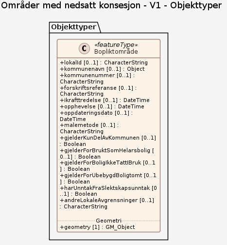
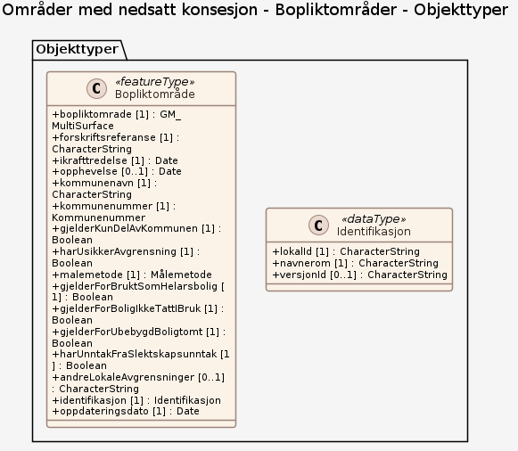
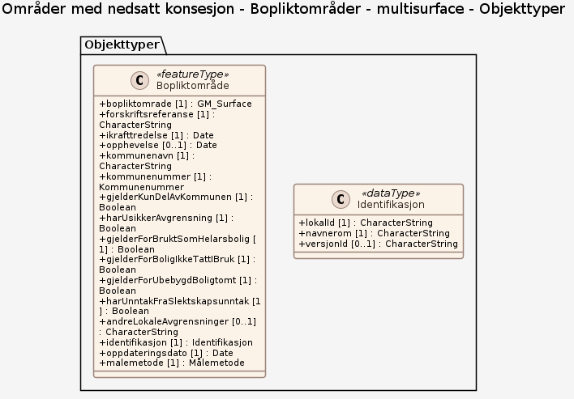

### Datamodell - V1

➡️ [Se full datamodell for omfang "V1" (diagram per pakke og objektkatalog)](v1/objektkatalog.html)

### Datamodell - Bopliktområder

➡️ [Se full datamodell for omfang "Bopliktområder" (diagram per pakke og objektkatalog)](bopliktomrader/objektkatalog.html)

### Datamodell - Bopliktområder - multisurface

➡️ [Se full datamodell for omfang "Bopliktområder - multisurface" (diagram per pakke og objektkatalog)](bopliktomrader-multisurface/objektkatalog.html)
